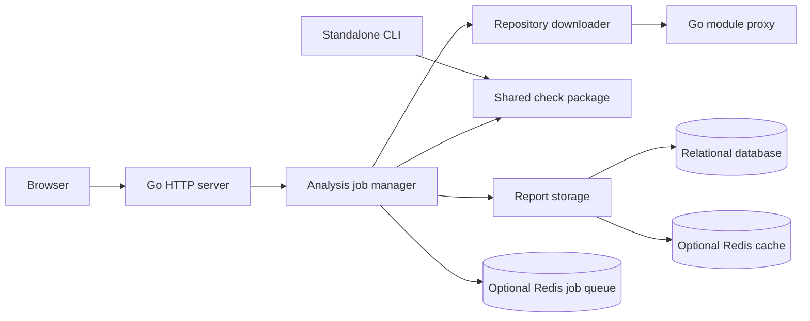

# System overview

Go Report Card has a web server, a standalone CLI, analyzer packages, relational persistence, and optional Redis services.

## Web request flow

1. The homepage serves embedded templates and static assets from `src/assets`.
2. A user submits a Go module or repository path. The `/checks` handler cleans and validates the path.
3. If a completed report is available and the request does not ask for a refresh, the service returns a redirect to that report.
4. Otherwise, an analysis job is queued. The browser polls for status and is directed to the report when the job completes.
5. Analysis downloads the module source, runs the checks in `src/check`, and saves the completed report in the relational database.

The report pages are served under `/report/`. Prometheus metrics are exposed at `/metrics`.

## Main packages

| Package | Responsibility |
|---|---|
| `src` | Server startup, route registration, embedded assets, and HTTP metrics. |
| `src/handlers` | Pages, report requests, check submissions, and analysis-job coordination. |
| `src/check` | Repository analyzers and score aggregation. Shared by the server and CLI. |
| `src/download` | Go module and repository source retrieval. |
| `src/storage` | Relational database stores, schema migrations, and Redis report caches. |
| `src/cmd/goreportcard` | Standalone CLI. |
| `src/tools` | Database and local repository maintenance commands. |
| `src/logging` | Log level filtering and colorized standard-library logging. |

## External services

The relational database stores completed reports and recent repository data. Redis is optional for a single local process; when configured, it provides caches and shared analysis-job coordination across app instances. See [Data model and persistence](data-model.md), [Analysis jobs](analysis-jobs.md), and [Caching](caching.md).
